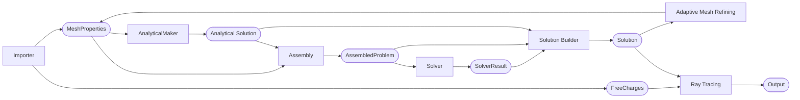

# Architecture

## Data flow

Rectangles are steps, rounded nodes are data.



## Units and PDE convention

All stages share one unit system (matching Nebula):

- **Length:** nanometers (`nm`). Coordinates in `.msh`, `.cha`, and `.pri` are read as-is in `nm`; `.mat` `screening_length` values are converted to `nm`.
- **Potential:** volts (`V`).
- **Permittivity:** dimensionless relative permittivity $\varepsilon_r$ (without $\varepsilon_0$ on the left-hand side).
- **Equation:** inside each non-metal tet, with $c = \varepsilon_r / \lambda^2$ when `mesh.screened && screening_length > 0` (and $c = 0$ otherwise):
  $$-\nabla \cdot (\varepsilon_r \nabla u) + c u = f = \frac{\rho}{\varepsilon_0}$$
  so $f$ has units $\text{V}/\text{nm}^2$, and a point charge of $q$ elementary charges contributes $q \cdot \frac{e}{\varepsilon_0\,\mathrm{nm}} \approx 18.0951\,q\;\text{V}\cdot\text{nm}$ to the integrated right-hand side.
- **Boundary conditions:** Dirichlet prescribes $u\;\text{[V]}$; Neumann and Robin satisfy $\varepsilon_r \frac{\partial u}{\partial n} + \alpha u = g$ with $g$ in $\text{V}/\text{nm}$ and $\alpha$ in $\text{nm}^{-1}$ ($\alpha = 0$ for Neumann). Outer faces with no `BoundaryElement` entry are treated as natural homogeneous Neumann ($g = 0, \alpha = 0$).

## Data classes

Shared problem-data structs live in the root headers under `include/`. They hold only problem
data, never run metadata like timing or warnings.

### MeshProperties (`include/mesh_properties.h`)

The mesh with its materials, boundary conditions, and trapped charges. Elements and boundary
elements store only indices; coordinates, materials, and boundary conditions are looked up in
the other vectors.

```cpp
struct MeshProperties {
    struct Element {                              // volume element (tet)
        std::array<uint32_t, 4> node;             // indices into nodes
        uint16_t material;                        // index into materials
    };

    struct BoundaryElement {                      // surface element (triangle)
        std::array<uint32_t, 3> node;             // indices into nodes
        uint16_t boundary_condition;              // index into boundary_conditions
    };

    enum class BcType { Dirichlet, Neumann, Robin };
    struct BoundaryCondition {
        BcType type;
        double value;                             // Dirichlet: u [V]; Neumann and Robin: g [V/nm]
        std::optional<double> alpha;              // Robin only [1/nm]: eps_r * du/dn + alpha * u = g
    };

    struct Material {
        std::string name;                         // e.g. "silicondioxide"
        double eps_r = 1;                         // relative permittivity
        double screening_length = 0;              // nm; 0 = no screening, else c = eps_r / screening_length^2
        bool is_metal = false;                    // conductor: one potential everywhere inside
        std::optional<double> voltage;            // prescribed potential [V]; empty if not prescribed
    };

    struct TrappedCharge {
        std::array<double, 3> position;           // x, y, z in nm
        int32_t               value;              // in elementary charges: +1 hole, -1 electron
    };

    // neighbours entry for a face on the outside of the mesh.
    static constexpr uint32_t no_neighbour = std::numeric_limits<uint32_t>::max();
    static constexpr std::array<uint32_t, 4> no_neighbours{no_neighbour, no_neighbour, no_neighbour, no_neighbour};

    std::vector<std::array<double, 3>> nodes;               // nodes[id] = {x, y, z} in nm
    std::vector<Element>               elements;
    std::vector<BoundaryElement>       boundary_elements;   // outer faces with an explicit BC only; unlisted outer faces are natural (g = 0, alpha = 0)
    std::vector<BoundaryCondition>     boundary_conditions;
    std::vector<Material>              materials;
    std::vector<TrappedCharge>         charges;             // all trapped charges; grows after every batch
    bool                               screened = true;     // true: solve screened Poisson (-div(eps_r grad u) + c u = f); false: unscreened (c = 0)

    // The tets around each tet. neighbours[e][i] is the tet on the other side of the face
    // opposite node i of element e, or no_neighbour if that face is on the outside of the
    // mesh. Same index as elements; always filled (by the Importer and every refiner).
    std::vector<std::array<uint32_t, 4>> neighbours;
};
```

### FreeCharges (`include/free_charges.h`)

The primary electrons, passed to the ray tracer. One entry holds what one record of a `.pri` file holds.

```cpp
struct FreeCharges {
    struct Electron {
        std::array<double, 3>  position;    // x, y, z in nm
        std::array<double, 3>  direction;   // direction of motion, not normalised
        double                 energy;      // kinetic energy in eV
        std::array<int32_t, 2> pixel;       // image pixel this electron belongs to
    };

    std::vector<Electron> electrons;
};
```

### AssembledProblem (`include/assembled_problem.h`)

The linear system $A x = f$.

$A$ has one row per unknown, not one per node. `row` gives the row of each node; several
nodes may share a row (all nodes of one connected floating metal share one row). Nodes
whose value is known in advance (Dirichlet boundaries and prescribed-voltage metals) have
no row and are listed in `known`. The potential at every node follows from `SolverResult::x`:

- node with a row: `u[i] = x[*row[i]]`
- every `(node, value)` in `known`: `u[node] = value`

```cpp
struct AssembledProblem {
    Eigen::SparseMatrix<double>              A;
    std::vector<double>                      f;       // right-hand side, one entry per row of A
    std::vector<std::optional<uint32_t>>     row;     // per node: its row in A, or empty if its value is known
    std::vector<std::pair<uint32_t, double>> known;   // (node, value) for every node whose value is known
};
```

## Stage results

Each stage returns `{ outputs..., Info info }`, where `outputs` are what downstream stages
read and `info` holds diagnostics for people and logs (at least `time` and `warnings`, plus
any useful counts or timings). AMR's `AdaptationResult` is documented in
[src/amr/architecture.md](src/amr/architecture.md).

### MeshImportResult and FreeChargesImportResult (`include/importer/importer.h`)

```cpp
struct MeshImportResult {
    struct Info {
        double                   time = 0;            // total, in seconds
        double                   time_read = 0;       // reading the .msh
        double                   time_geometry = 0;   // checking the geometry
        std::vector<std::string> warnings;            // e.g. a volume without a material file
    };

    MeshProperties mesh;
    Info           info;
};

struct FreeChargesImportResult {
    struct Info {
        double                   time = 0;            // total, in seconds
        std::vector<std::string> warnings;
    };

    FreeCharges charges;
    Info        info;
};
```

### AssemblyResult (`include/assembled_problem.h`)

```cpp
struct AssemblyResult {
    struct Info {
        double   time = 0;                      // total, in seconds
        double   time_assemble_A = 0;
        double   time_assemble_f = 0;
        uint64_t nnz = 0;                       // nonzeros in A
        uint32_t n_dirichlet = 0;               // eliminated nodes
        std::vector<std::string> warnings;
    };

    AssembledProblem problem;
    Info             info;
};
```

### SolverResult (`include/solver_result.h`)

```cpp
struct SolverResult {
    struct Info {
        double   time = 0;                      // total, in seconds
        uint32_t iterations = 0;
        double   residual = 0;                  // final relative residual
        std::vector<std::string> warnings;      // e.g. no convergence within the iteration limit
    };

    std::vector<double> x;                      // one value per row of A
    Info                info;
};
```

## Pipeline stages

- **Importer:** Reads `.msh`/`.msh2`, material `.yaml`/`.mat`, `.cha`, and `.pri` files and
  returns `MeshImportResult { mesh, info }` and `FreeChargesImportResult { charges, info }`
  (`include/importer/importer.h`). Details: [src/importer/architecture.md](src/importer/architecture.md).
- **AnalyticalMaker:** *Not defined yet* (see Open points).
- **Assembly:** Output contract (`AssembledProblem` / `AssemblyResult`) is defined above;
  the C++ interface and `Analytical Solution` input are still open.
- **Solver:** Solves $A x = f$. Takes `A` and `f` from `AssembledProblem` and returns a
  `SolverResult`.
- **Solution Builder:** Builds `Solution` from `SolverResult::x`, `AssembledProblem` (`row`,
  `known`), and `Analytical Solution`.
- **Adaptive Mesh Refining:** Session-based `MeshAdapter` (`include/amr/mesh_adapter.h`) and
  `ErrorBasedAdapter` (`include/amr/error_based_adapter.h`), taking `MeshProperties` and a
  `RefinementInput` and returning an `AdaptationResult`. Details: [src/amr/architecture.md](src/amr/architecture.md).
- **Ray Tracing:** *Not defined yet*.

## Shared utilities & tooling

- **Common primitives (`include/common/`):** Physical/math constants (`constants.h`),
  quadrature rules on tetrahedra and triangles up to degree 20 (`quadrature.h`), and a
  coordinate-to-tetrahedron spatial lookup index over `MeshProperties` (`mesh_locator.h`).
  Details: [src/common/architecture.md](src/common/architecture.md).
- **Verification (`include/verification/`):** Test cases with known exact solutions (geometry,
  materials, BCs, charges, and analytical formula) plus a CLI to generate input files.
  Details: [src/verification/architecture.md](src/verification/architecture.md).
- **Driver (`include/poisson_driver.h`):** Placeholder header sketching the top-level solve
  loop, to be implemented once the remaining stage contracts are defined.
- **Stage CLIs & HDF5 I/O:** Thin per-stage executables under `cli/` and HDF5/JSON
  serialization under `src/io/`. Details: [cli/architecture.md](cli/architecture.md).
- **Experiment runner & cache:** Python orchestration, BLAKE3 caching, `compare(...)` sweeps,
  and saved-run evaluation. Details: [python/poisson_runner/architecture.md](python/poisson_runner/architecture.md).
- **Python test solver:** `scikit-fem`/`scipy`/`pyamg` stand-in for `Assembly` and `Solver`,
  used for closed-loop AMR testing. Details: [python/poisson_test_solver/architecture.md](python/poisson_test_solver/architecture.md).
- **Cluster scripts:** Slurm build and submission helpers for DelftBlue. Details:
  [scripts/delftblue/README.md](scripts/delftblue/README.md).

## Conventions

- **Naming:** Types/classes are `CamelCase`, variables and fields are `snake_case`.
- **Data vs. `Info`:** Keep problem-data structs free of run metadata (`time`, `warnings`,
  etc.); put those in the stage's `Result::Info` instead. A quick rule of thumb: if a later
  stage needs it, it's an output; if it's only for people/logs, it goes in `Info` (see
  [cli/architecture.md](cli/architecture.md) for how CLIs split outputs into `.h5` and `Info`
  into `.info.json`).
- **Keep stages decoupled:** Stage interfaces should talk through the shared structs in
  `include/` rather than depending on each other's internals.

## Open points

- **`Analytical Solution`:** Contents not decided. Planned as local singularity subtraction
  (P3M): a smooth cloud per charge in $f$, plus an analytical correction within $r_c$ of each
  charge.
- **`Solution`:** Contents not decided; depends on `Analytical Solution`. Will be a data
  class returned as `SolutionBuildResult { solution, info }`.
- **`Output`:** Contents not decided.
