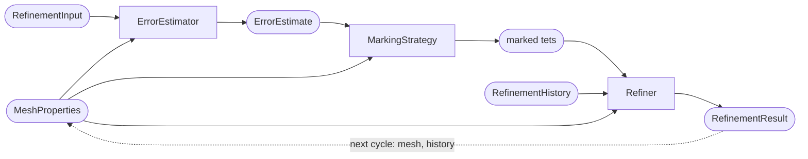

# Adaptive mesh refinement

The module that improves the mesh after a solve. It is three steps, each an interface
with interchangeable methods:

| Step | Interface | Methods | Header |
|---|---|---|---|
| adapt (top-level) | `MeshAdapter::start()` → `Session::adapt(mesh, input)` → `AdaptationResult` | `ErrorBasedAdapter` (extensible to metric-based, etc.) | `include/amr/mesh_adapter.h`, `include/amr/error_based_adapter.h` |
| estimate | `ErrorEstimator::estimate(mesh, input)` → `ErrorEstimate` | `ResidualEstimator`, `KellyEstimator`, `RecoveryEstimator` | `include/amr/error_estimator.h` and one header per method |
| mark | `MarkingStrategy::mark(mesh, eta)` → sorted tet indices | `DorflerMarking`, `MaximumMarking`, `FixedFractionMarking`, `EquidistributionMarking` | `include/amr/marking.h` |
| refine | `Refiner::refine(mesh, marked, history)` → `RefinementResult` | `LongestEdgeBisection`, `RedGreenRefinement` | `include/amr/refiner.h` and one header per method |

The top-level solver loop (`PoissonDriver`) is sketched as a placeholder in
`include/poisson_driver.h` until `AnalyticalMaker`, `Assembly`, `Solver`, and `Solution`
contracts exist.

## Top-level `MeshAdapter` and `Session`

`MeshAdapter` is the virtual boundary between the outer solver driver and any mesh
adaptation method. A configured `MeshAdapter` is `const` and reusable; calling `start()`
returns a `MeshAdapter::Session` that holds per-run state across cycles and releases it on
destruction.

`ErrorBasedAdapter` composes `(ErrorEstimator, MarkingStrategy, Refiner)` with its own
stopping settings (`absolute_tolerance`, `relative_tolerance`, `max_elements`,
`estimate_at_limit`). Its session privately stores `RefinementHistory` (for red-green
refinement) and the first cycle's error (for `relative_tolerance`), so neither leaks into
`MeshAdapter` or `PoissonDriver`. A future metric-based adapter implements `MeshAdapter`
directly without using `ErrorEstimator`, `MarkingStrategy`, or `RefinementHistory`.

## Shared shape of the interfaces

As in pde2d: the public function of each interface (`estimate`, `mark`, `refine`,
`Session::adapt`) is **not virtual**. It checks the input/postconditions, times the work,
applies the rules every method shares, and then calls a private virtual function with the
method's own work (`indicators`, `select`, `refine_marked`, `adapt_step`). So the checks
are written once and no method can skip them.

Each method has a nested `Settings` struct, given to its constructor and checked there
(`std::invalid_argument`). The default constructor (where meaningful) uses default settings.

Each result has a nested `Info` with typed fields for the common numbers (`time`, element
and node counts, `total`, `error_estimate`, `warnings`), plus a `details` map for
method-specific diagnostics (`element_part`, `red`, `passes`, ...). `AdaptationResult::Info`
also carries a `std::vector<StageInfo> stages` recording every internal stage that actually
ran (`estimate`, `mark`, `refine`, or whatever stages a future adapter uses).

## Estimation

`RefinementInput` is the boundary to the rest of the code: `u` (one value per node,
Dirichlet nodes included), `source` (the smooth right-hand side f(x, element), the same f
that Assembly integrates) and `point_sources` (deltas that are still deltas). The
estimators do not know how the analytical solution is represented.

The equation they assume, per tet with its material's `eps_r` and `screening_length`:
`-div(eps grad u) + c u = f`, `eps = eps_r`, `c = eps_r / screening_length^2`.

| | element term | face jumps | Neumann / Robin faces | uses `source` |
|---|---|---|---|---|
| residual | `h_K^2/eps_K ‖f − c u_h‖²` | `h_F/(2 eps_F) ‖J_F‖²` | `h_F/eps_K ‖R_F‖²` | yes |
| Kelly | — | same | same | no |
| recovery | `∫ eps |G − ∇u_h|²` (or the flux form) | — | — | no |

Shared rules (in `ErrorEstimator::estimate`):

- **Metal** tets get `eta = 0`; faces that touch a metal are skipped like Dirichlet faces.
- **Point sources**: `PointSourceRule::exclude_patch` (default) sets `eta = 0` on every tet
  that shares a node with the tet containing a non-zero delta, because near a delta every
  estimator keeps growing under refinement. `ignore` leaves them out. A source without an
  element hint is located with `MeshLocator` (`include/common/mesh_locator.h`).
- An outer face without a boundary element is natural (`g = 0`).

Recovery averages per material by default (`per_material = true`): neither `grad u` nor
`eps grad u` is continuous across an interface, so averaging across it would report error
on every interface tet forever.

Quadrature comes from `include/common/quadrature.h` (collapsed Gauss rules on tets and
triangles, any degree up to 20, positive weights); it lives in `common/` because Assembly
will need it too.

## Marking

The rules of pde2d unchanged: indicators must be finite and non-negative, zeros are never
marked, the result is sorted and unique, ties go by tet index.

## Refinement

Both refiners share one operation (`src/amr/refinement_common.*`): replace a tet by
children given in its local terms (nodes and edge midpoints). From that local description
the children's faces inherit the boundary elements they lie in, so boundary triangles are
split exactly like the tets and keep their condition and orientation. A child keeps its
parent's material; children are turned to positive volume; `neighbours` is rebuilt.

`Parents` gives, per new tet, the input tet that contains it, and per new node the two
nodes it is the midpoint of.

| | longest-edge bisection | red-green |
|---|---|---|
| unit step | bisect at the longest edge (2 children) | red: 8 children; green: 2, 3 or 4 |
| conformity | longest-edge propagation, in passes | green closure, red where no green pattern fits |
| state between cycles | none | `RefinementHistory`: the green families |
| shape | bounded in practice; not proven in 3D | bounded (green tets are never refined further) |

`RefinementHistory` exists only for red-green: green tets must not be subdivided again, so
the next refinement has to know which tets are green and what their parent was. The
caller passes the previous result's history back with its mesh.

## Tests

`tests/test_estimators.cpp`, `test_marking.cpp`, `test_refiners.cpp`, `test_adapter.cpp`,
`test_quadrature.cpp`. With no solver yet, the estimators and `ErrorBasedAdapter` are tested
on interpolants: exact piecewise linear functions (including a kink at a material interface
with continuous flux) must give 0, and a smooth function must give O(h). The refiners are
checked after every cycle for positive volumes, conformity, boundary conditions per area,
orientation, neighbours and parents, on a structured and on a jittered mesh. `test_adapter`
verifies session-scoped red-green history, absolute/relative tolerances, `max_elements` with
and without `estimate_at_limit`, `StageInfo` collection, and the `PoissonDriver` placeholder.

## Open points

- `RefinementHistory` is now hidden from outer callers inside `ErrorBasedAdapter`'s session,
  but it still appears in the lower-level `Refiner::refine()` signature (and in
  `ErrorBasedAdapter::adapt_once()` for stateless CLI invocations).
- Faces between a dielectric and a floating metal (no voltage) are skipped like Dirichlet
  faces.
- An interior face with a Neumann or Robin boundary element is treated as an ordinary
  interior face, with a warning.
- On a face shared between an excluded point-source tet and a non-excluded neighbour, the
  non-excluded neighbour still receives half of that face's flux jump.
- No coarsening, no maximum refinement level.
